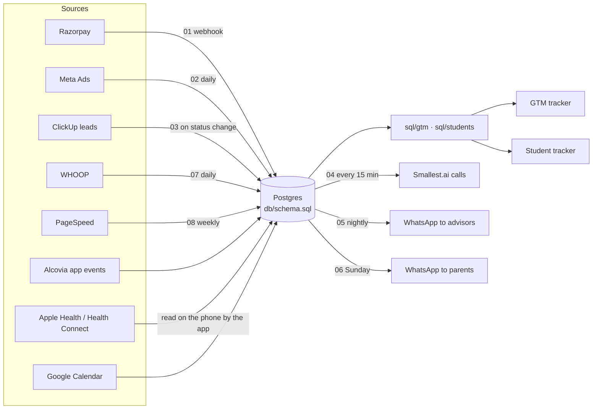

# Alcovia – Product, Systems & Analytics Lead assignment

One Postgres database behind two dashboards and eight n8n automations. Every number on the dashboards is the output of a SQL file in this repo, run on seed data. All data is dummy except the ₹3,999 workshop seat price; names are fictional.

| | Link |
| --- | --- |
| Writeup (2 pages) | [`docs/writeup.pdf`](docs/writeup.pdf) |
| Full plan with diagrams | [`docs/full-plan.pdf`](docs/full-plan.pdf) |
| Sample PRD: daily focus loop | [`docs/prd-daily-focus-loop.md`](docs/prd-daily-focus-loop.md) |
| GTM tracker (revenue, funnel, campaigns) | [live](https://juhi-kpd.github.io/alcovia-assignment/dashboards/gtm-tracker.html) · [`source`](dashboards/gtm-tracker.html) |
| Student tracker (cohort and per-student) | [live](https://juhi-kpd.github.io/alcovia-assignment/dashboards/student-tracker.html) · [`source`](dashboards/student-tracker.html) |

## How the pieces fit



## Repo map

| Path | What it is |
| --- | --- |
| `db/schema.sql` | Data model: GTM (campaigns, creatives, ad_daily, leads, payments, invoices, targets), people, day-level rigour (app usage, focus, quiz, timetable, wearables), academics (subjects, chapters, 5-stage rigour, tasks, exams), program activities and ratings, roadmaps, alerts, outreach log |
| `db/seed.sql` | Generated dummy data: May–Oct 2026 for GTM, 1 Aug–16 Oct 2026 for 20 students |
| `sql/gtm/` | 7 metric queries for the GTM tracker |
| `sql/students/` | 8 metric queries for the student tracker |
| `n8n/` | 8 workflow exports (import in n8n: Workflows → Import from file) |
| `dashboards/` | The two dashboards: single HTML files with the query output embedded |
| `docs/` | Writeup, full plan and a sample PRD |
| `scripts/` | Seed generator, dashboard export, n8n builder and checker |

## Metric definitions

Every query has a `params` CTE at the top with the date range; change it, or pass it in from Looker Studio / Metabase.

**GTM tracker**

| Ask in the brief | Query | Definition |
| --- | --- | --- |
| Target vs achievement, trial vs full, students onboarded, workshop revenue, program vs workshop | `gtm/01` | Razorpay payments by month and product vs `revenue_targets` |
| Invoice generated but not paid | `gtm/02` | Unpaid invoices raised in the period, days past due |
| Renewals coming up for trial teens | `gtm/03` | Trials ending in the next 30 days, with app days in the last 14 |
| Funnel: leads → qualified → discovery set (show-up) → ambition interview (drop-off) → architect session → paid | `gtm/04` | Leads created in the period; each stage = its timestamp is set; step % = share of the previous stage |
| Cost per qualified lead, conversion %, organic leads, average lead journey | `gtm/05` | Program ad spend ÷ qualified leads; paid ÷ leads; days to pay and days to drop, plus where people drop |
| Highest / lowest CTR assets, frequency 3+ | `gtm/06` | Per creative: CTR, frequency in the latest month, cost per result |
| Which campaigns to drop, refresh, scale | `gtm/06` | drop = cost per result > 1.6× target and CTR < 1% · refresh = frequency ≥ 3 or CTR < 1% · scale = cost ≤ target and frequency < 2.5 |
| Landing page health (drop-off, load time) | `gtm/07` | 1 − form submits ÷ visits; latest mobile LCP from PageSpeed |

Targets (₹2,500 per qualified lead, ₹800 per workshop seat) are assumptions. Maximum cost per qualified lead = average first payment × share we can spend on acquisition ÷ qualified leads per sale.

**Student tracker** – every activity on three lenses: did Alcovia do it (quantity), did Alcovians like it (quality), how did they perform.

| Area | Query | Definition |
| --- | --- | --- |
| Day level: app time, focus time, 8pm quiz, timetable, sleep and activity | `students/01` | Per student per period; quiz attempt % = attempts ÷ quizzes held |
| Syllabus completion and rigour | `students/02` | Chapters started ÷ total vs 25% a quarter from 1 April; readiness = 20 points per rigour stage reached (read, notes, practice > 70%, timed past paper, exam-ready > 80%) ÷ chapters |
| Task completion, deadline adherence, time-estimate accuracy | `students/03` | Advisor-set tasks due in the period |
| Workshops, pods, peer, mentor calls, branding, quarterly events | `students/04` | Held ÷ planned, attendance, 1-tap rating, facilitator soft-skill score |
| Academic targets | `students/05` | Exam result vs target agreed with student and parent |
| Career, personal, academic roadmaps | `students/06` | Career done or not; personal milestones hit; academic targets set |
| Advisor inputs | `students/07` | Targets signed off, students logging 3+ days a week, alerts actioned within 48 h |
| Weekly review list | `students/08` | Open alerts by student and advisor |

## Automations (n8n)

| Workflow | Trigger | Does |
| --- | --- | --- |
| `01_razorpay_payments` | Razorpay webhook | Verifies the signature, writes payments (product, workshop, ad attribution from UTM), marks invoices paid |
| `02_meta_ads_daily` | Daily 06:00 | Pulls yesterday's ad-level insights, upserts campaigns, creatives and `ad_daily` |
| `03_clickup_lead_stages` | ClickUp status change | Maps the lead's ClickUp status to its funnel timestamp; records the stage a lost lead dropped at |
| `04_smallest_ai_calls` | Every 15 min, 09:00–20:00 | AI reminder calls 24 h and 1 h before discovery calls; renewal call 14 days before a trial ends; never twice |
| `05_nightly_advisor_alerts` | Daily 21:30 | Raises overdue-task, subject-behind and inactive alerts; one WhatsApp per advisor |
| `06_weekly_parent_summary` | Sunday 18:00 | Three numbers and one line per student on WhatsApp |
| `07_whoop_daily_sync` | Daily 07:00 | WHOOP recovery and sleep into `wearable_daily` |
| `08_pagespeed_weekly` | Monday 07:00 | Mobile load time per landing page |

Apple Health and Health Connect (Samsung) have no cloud API, so the app reads them on the phone and writes `wearable_daily` through the app backend. Garmin needs approval for its Health API before a push workflow can be added.

Environment variables used: `RAZORPAY_WEBHOOK_SECRET`, `META_AD_ACCOUNT_ID`, `CLICKUP_TEAM_ID`, `CLICKUP_LEADS_LIST_ID`, `SMALLEST_OUTBOUND_URL`, `SMALLEST_REMINDER_AGENT_ID`, `SMALLEST_RENEWAL_AGENT_ID`, `WHATSAPP_PHONE_NUMBER_ID`, `PAGESPEED_API_KEY`; the Code node in 01 needs `NODE_FUNCTION_ALLOW_BUILTIN=crypto`.

## Run it

```bash
createdb alcovia
psql -d alcovia -f db/schema.sql -f db/seed.sql
psql -d alcovia -f sql/gtm/04_funnel_stages.sql            # any metric query

# rebuild everything from scratch
python3 scripts/generate_seed.py                            # db/seed.sql + student data
PGURI=postgresql://localhost/alcovia python3 scripts/export_dashboard_data.py   # runs sql/gtm, embeds results
python3 scripts/build_n8n_workflows.py                      # n8n/*.json
PGURI=postgresql://localhost/alcovia python3 scripts/check_n8n_sql.py           # checks every Postgres node's SQL
```

## What was tested

- Schema, seed and all 15 metric queries run on PostgreSQL 16.
- Dashboards: opened in Chromium at desktop and phone width with no script errors; GTM numbers match the SQL output exactly (they are the SQL output).
- n8n (1.90): all 8 workflows import cleanly and open in the editor (screenshots in [`docs/n8n-screenshots`](docs/n8n-screenshots)). The SQL in all 16 Postgres nodes prepares against the schema. Workflows 05 (nightly alerts) and 06 (parent summary) were run end to end against the seed database with WhatsApp replaced by a local mock: 05 raised alerts, sent one message per advisor and logged them, and a second run raised nothing new; 06 sent one summary per parent. The other flows need real Meta, ClickUp, Razorpay, Smallest.ai or WHOOP credentials to run end to end.

## Try a workflow yourself

1. Start n8n (`npx n8n` or n8n Cloud) and add a Postgres credential named **Alcovia Postgres** pointing at a database loaded with `db/schema.sql` and `db/seed.sql`.
2. Workflows → Import from file → pick a file in `n8n/`.
3. Click **Test workflow**. Scheduled flows have a **Run manually** trigger for this. For 05 and 06, set `advisors.phone` / `students.parent_phone` first, and point the WhatsApp node at a test endpoint such as webhook.site.
